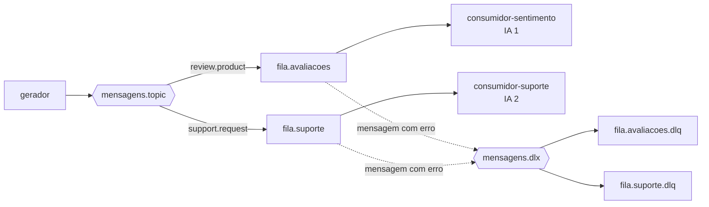
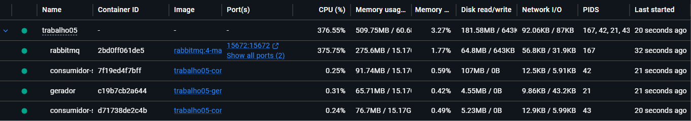
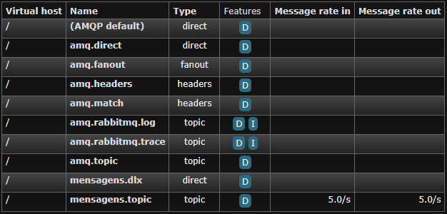
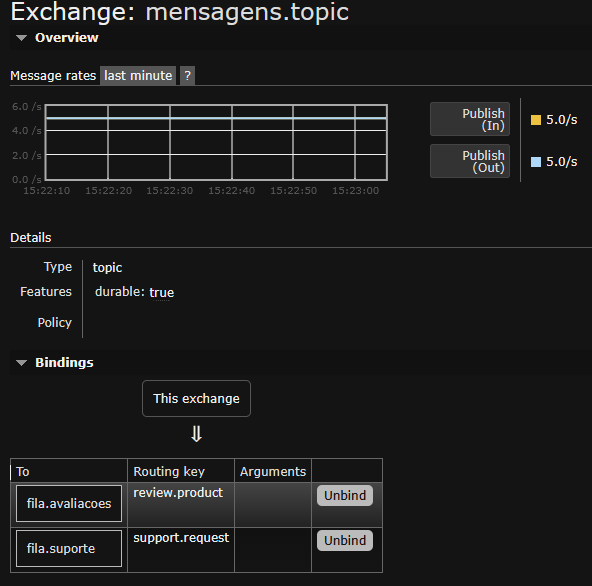
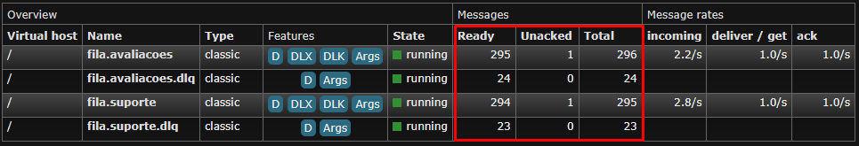
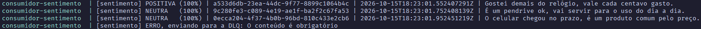
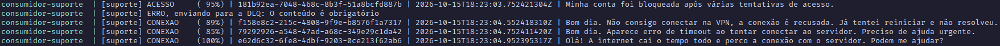
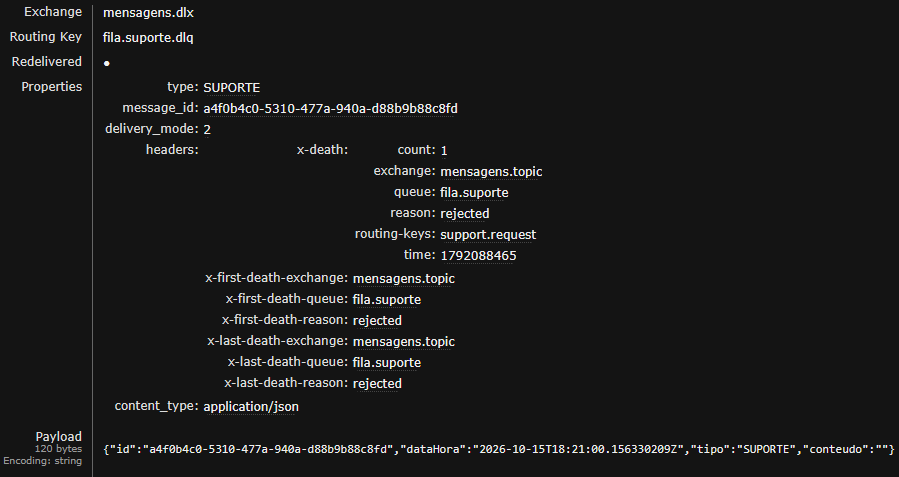

# Sistema Distribuído de Classificação de Mensagens com RabbitMQ

Atividade 05 da disciplina de Sistemas Distribuídos (UFPI — CSHNB). Um gerador publica avaliações de produtos e solicitações de suporte no RabbitMQ, e dois consumidores independentes classificam essas mensagens com IA embarcada, usando a biblioteca Smile.

**Aluno:** João Vitor Santana Lima (20249006849)  
**Vídeo de demonstração:** [Vídeo no YouTube](https://youtu.be/-OMzGMnmGSo)

## Tecnologias

- Java 25 e Gradle 9.6.0 (projeto multimódulo)
- RabbitMQ 4 com interface de administração (`rabbitmq:4-management`)
- RabbitMQ Java Client 5.37.0 e Jackson 2.22.3
- Smile 6.3.0
- Docker e Docker Compose

## Arquitetura

O sistema roda em 4 containers conectados à mesma rede (`rede-mensagens`):

| Container | Função |
|---|---|
| `rabbitmq` | Broker de mensagens, com a interface de administração na porta 15672 |
| `gerador` | Gera avaliações e solicitações de suporte e publica no exchange |
| `consumidor-sentimento` | Consome as avaliações e classifica o sentimento (IA 1) |
| `consumidor-suporte` | Consome as solicitações e classifica o tipo de problema (IA 2) |



### Topologia no RabbitMQ

| Recurso | Tipo | Detalhe |
|---|---|---|
| `mensagens.topic` | Topic exchange | Recebe tudo o que o gerador publica |
| `fila.avaliacoes` | Fila | Binding `review.product`, com DLX `mensagens.dlx` |
| `fila.suporte` | Fila | Binding `support.request`, com DLX `mensagens.dlx` |
| `mensagens.dlx` | Direct exchange | Recebe as mensagens rejeitadas pelos consumidores |
| `fila.avaliacoes.dlq` e `fila.suporte.dlq` | Filas (DLQ) | Guardam as mensagens com erro de cada fila |

Os três serviços Java declaram essa topologia ao iniciar (classe `Topologia`), então a ordem de subida não importa.

### Mensagem

Cada mensagem é um JSON com identificador único, data/hora de geração, tipo e conteúdo:

```json
{
  "id": "9b0b05e1-3fd1-40d7-b74a-7f491a750b6f",
  "dataHora": "2026-10-13T14:44:36.725354230Z",
  "tipo": "AVALIACAO",
  "conteudo": "Era melhor ter queimado o dinheiro, o mouse não presta e quero devolução."
}
```

O tipo também vai na routing key e na propriedade `type` da mensagem AMQP.

### Fluxo

1. O **gerador** publica 5 mensagens por segundo, sorteando entre avaliação e solicitação de suporte. A cada 10 mensagens, publica uma de propósito com o conteúdo vazio, para demonstrar a DLQ.
2. O **topic exchange** encaminha cada mensagem para a fila correspondente à sua routing key.
3. Cada **consumidor** usa ACK manual e `basicQos(1)`: recebe uma mensagem por vez, classifica, espera 1 segundo e só então confirma com `basicAck`. Cada fila recebe em média 2,5 mensagens por segundo e o consumidor processa 1, então as filas crescem e isso aparece na interface do RabbitMQ.
4. Se o processamento falhar (JSON inválido, campo obrigatório vazio ou texto sem nenhuma palavra conhecida pela IA), o consumidor faz `basicNack` sem reenfileirar, e o RabbitMQ encaminha a mensagem para a DLQ da fila em vez de descartá-la.

### Estrutura do projeto

```text
.
├── docker-compose.yml
├── docs/
│   ├── trabalho05.pdf
│   └── evidencias/              capturas de tela da execução
└── app/                         projeto Gradle multimódulo
    ├── common/                  mensagem, JSON, configuração, conexão e topologia do RabbitMQ
    ├── gerador/                 gerador de mensagens + Dockerfile
    ├── consumidor-sentimento/   consumidor 1, IA 1, treino-sentimento.csv + Dockerfile
    └── consumidor-suporte/      consumidor 2, IA 2, treino-suporte.csv + Dockerfile
```

## Como executar

### Pré-requisitos

Docker e Docker Compose. Não é preciso ter Java instalado, porque a compilação acontece dentro dos containers.

### Subir o sistema

Na raiz do repositório:

```bash
docker compose up --build -d
```

O primeiro build leva alguns minutos, porque baixa as imagens base e as dependências.

Conferir os containers:

```bash
docker compose ps
```

Acompanhar a geração e a classificação:

```bash
docker compose logs -f gerador consumidor-sentimento consumidor-suporte
```

Interface do RabbitMQ: http://localhost:15672 (usuário `admin`, senha `admin`).

Encerrar:

```bash
docker compose down
```

### Configuração

Variáveis de ambiente definidas no `docker-compose.yml`:

| Variável | Serviço | Valor | Significado |
|---|---|---|---|
| `MENSAGENS_POR_SEGUNDO` | gerador | 5 | Taxa de geração de mensagens |
| `ERRO_A_CADA` | gerador | 10 | Publica 1 mensagem inválida a cada N (0 desliga) |
| `ATRASO_MS` | consumidores | 1000 | Tempo de processamento de cada mensagem, em ms |
| `RABBITMQ_HOST` | todos | rabbitmq | Endereço do broker na rede Docker |

`RABBITMQ_PORT`, `RABBITMQ_USER` e `RABBITMQ_PASS` também podem ser definidas; os padrões são `5672`, `admin` e `admin`.

### Executar sem Docker (desenvolvimento)

Requer JDK 25. Suba só o broker e rode cada serviço em um terminal separado, dentro de `app/`:

```bash
docker compose up -d rabbitmq
./gradlew :gerador:run
./gradlew :consumidor-sentimento:run
./gradlew :consumidor-suporte:run
```

## Descrição das IAs

Os dois consumidores usam aprendizado de máquina supervisionado com o classificador **Naive Bayes multinomial** da biblioteca Smile (`smile.classification.DiscreteNaiveBayes`). Cada consumidor tem o seu próprio modelo, treinado com o seu próprio conjunto de dados quando o serviço inicia.

### Como funciona

1. **Leitura do treino:** o consumidor lê o CSV de treino (`ROTULO;texto`) em `src/main/resources`.
2. **Palavras:** cada texto é convertido para minúsculas e quebrado em palavras.
3. **Vocabulário:** cada palavra diferente vista no treino recebe uma posição.
4. **Vetorização (bag-of-words):** cada frase vira um vetor com a contagem de cada palavra do vocabulário.
5. **Treino:** `modelo.update(x, y)` aprende, para cada classe, a frequência de cada palavra.
6. **Classificação:** o texto da mensagem passa pelos passos 2 e 4, e `modelo.predict(x, probabilidades)` devolve a classe mais provável e a probabilidade dela, exibida como porcentagem no console.

Palavras que não estão no vocabulário são ignoradas. Se nenhuma palavra da mensagem for conhecida, ela é tratada como erro e vai para a DLQ.

### IA 1 — Análise de sentimento

- **Consumidor:** `consumidor-sentimento`
- **Classes:** `POSITIVA`, `NEGATIVA` e `NEUTRA`
- **Treino:** `treino-sentimento.csv`, com 60 frases (20 por classe)

```text
[sentimento] NEGATIVA (100%) | Era melhor ter queimado o dinheiro, o mouse não presta e quero devolução.
[sentimento] POSITIVA (100%) | Estou embasbacado com o tablet, acabamento impecável e ótimo custo-benefício.
[sentimento] NEUTRA   (100%) | Produto mediano, o teclado funciona, mas não tem nada de especial.
```

### IA 2 — Classificação de solicitações de suporte

- **Consumidor:** `consumidor-suporte`
- **Classes:** `ACESSO`, `DESEMPENHO` e `CONEXAO` (problema de acesso, de desempenho e de conexão)
- **Treino:** `treino-suporte.csv`, com 36 frases (12 por classe)

```text
[suporte] ACESSO     (100%) | Esqueci minha senha e o e-mail de recuperação não chega.
[suporte] DESEMPENHO ( 84%) | Boa tarde. A tela fica travada e o sistema responde com muita lentidão.
[suporte] CONEXAO    ( 99%) | Boa tarde. Aparece erro de timeout ao tentar conectar ao servidor.
```

No console, cada linha também mostra o id e a data/hora da mensagem.

### Limitações

Os conjuntos de treino foram escritos à mão para o mesmo domínio das mensagens do gerador: as frases são diferentes, mas o vocabulário é compartilhado. Testadas com todas as combinações de frases que o gerador produz, as duas IAs acertaram 100% (216 avaliações e 288 solicitações). Para classificar textos livres, escritos por qualquer pessoa, seria preciso um conjunto de treino maior e mais variado.

## Requisitos atendidos

| Requisito | Implementação |
|---|---|
| Pelo menos 5 mensagens por segundo, de dois tipos | `GeradorApp` e `GeradorDeTextos` |
| Topic exchange com `review.product` e `support.request` | `Topologia` |
| Uma fila para cada consumidor | `fila.avaliacoes` e `fila.suporte` |
| Interface de administração | imagem `rabbitmq:4-management`, porta 15672 |
| IA própria em cada consumidor, com Smile | `ClassificadorSentimento` e `ClassificadorSuporte` |
| Consumo mais lento que a chegada | `basicQos(1)` e `ATRASO_MS` |
| Identificador, data/hora, tipo e conteúdo | record `Mensagem` |
| ACK manual | `basicConsume` com auto-ack desligado e `basicAck` |
| DLQ para mensagens com erro | `basicNack` sem requeue e exchange `mensagens.dlx` |
| Containers na mesma rede, via Docker Compose | `docker-compose.yml` e rede `rede-mensagens` |

## Evidências

### Containers em execução



### Exchanges



### Bindings do topic exchange



### Filas crescendo




### Classificação no console
Logs Consumidor Sentimento

Logs Consumidor Suporte


### Mensagem na DLQ


